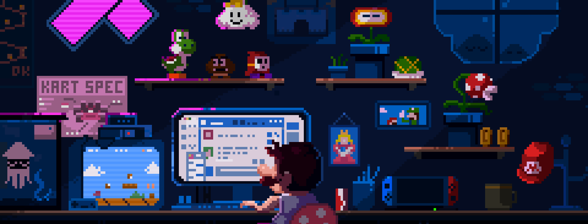
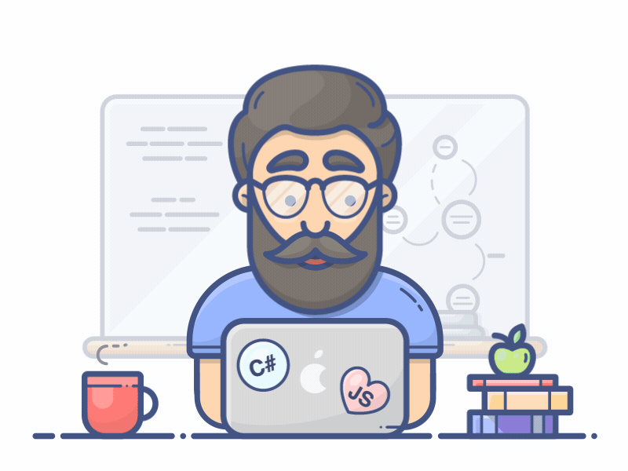

<h1 align="center">Hi 👋, I'm Muhaimin Rahim</h1>
<h3 align="center">A full-stack developer from Malaysia — building AI agent tooling and local-first apps</h3>

  

- 🔭 I'm currently building **DeepSeek Harness plugins and AI agent tooling** — [dsh-usage](https://github.com/minrahim1999/dsh-usage), [dsh-oc-tui](https://github.com/minrahim1999/dsh-oc-tui) (a fork adding agent modes) and [Aegis](https://github.com/minrahim1999/aegis)
- 🌱 I'm currently learning **Rust, local LLM runtimes and multi-agent pipelines**
- 💬 Ask me about **Laravel, PHP, JavaScript/TypeScript and AI agent harnesses**
- 📫 How to reach me **minrahim1999@gmail.com**
- 🌐 Portfolio **[www.minrahim.com](https://www.minrahim.com)**
- 🏢 I work at **LCP Buildsoft Technology** · Selangor, Malaysia
- ⚡ Fun fact **I'm Mystery**

<h3 align="left">Featured Projects:</h3>

| Project | What it does | Built with |
| :------ | :----------- | :--------- |
| [Phonemirror](https://github.com/minrahim1999/phonemirror) | Desktop app to mirror, screenshot and record an Android phone screen | `Rust` |
| [Aegis](https://github.com/minrahim1999/aegis) | Personal AI agent harness with an RLM core, persistent memory, skills and a messaging gateway | `TypeScript` |
| [llama-agentic](https://github.com/minrahim1999/llama-agentic) | Local agentic coding CLI powered by llama.cpp and GGUF models | `Python` |
| [Local Vision AI](https://github.com/minrahim1999/local-vision-ai) | Fully local text-to-image and image-to-text on Apple Silicon, Windows and Linux | `Python` |
| [LibreOffice MCP](https://github.com/minrahim1999/libreoffice-mcp) | MCP server for programmatic PowerPoint, Word and Excel control plus PDF export | `Python` |
| [AutoScope](https://github.com/minrahim1999/autoscope) | Desktop harness for recording and replaying web, Android and iOS tests | `Python` |
| [Ollama CLI](https://github.com/minrahim1999/ollama-cli) | Terminal client for Ollama with chat, tools, memory and snapshots | `TypeScript` |
| [dsh-usage](https://github.com/minrahim1999/dsh-usage) | Read-only local usage dashboard for DeepSeek Harness Desktop | `JavaScript` |

<h3 align="left">Connect with me:</h3>

<h3 align="left">Languages and Tools:</h3>

                           

<h3 align="left">GitHub Stats:</h3>

  
  

